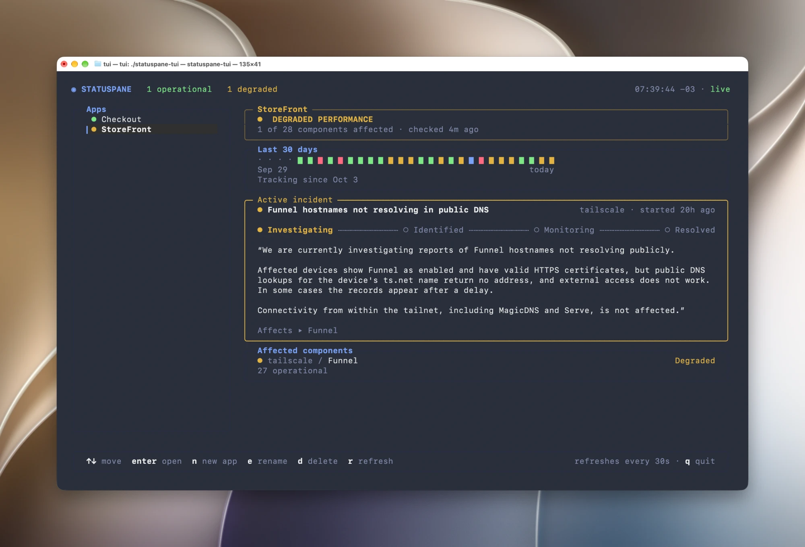

# StatusPane TUI

A terminal client for [StatusPane](https://statuspane.io): see your organization's apps and the
status of every component they watch, without leaving the terminal. It talks to the StatusPane
public API with an organization API key.



Contributors and coding agents: see [AGENTS.md](AGENTS.md).

## Build

Go and the dev tools are pinned in `mise.toml`.

```sh
mise install
mise run build      # vets, then builds ./statuspane-tui
```

Or install it straight from Go:

```sh
go install github.com/statuspane/tui/cmd/statuspane-tui@latest
```

## Configure

Create an organization API key in StatusPane, then either export it:

```sh
export STATUSPANE_API_KEY=sp_...
```

or put it in `~/.config/statuspane/config.toml` (`$XDG_CONFIG_HOME` is respected):

```toml
api_key = "sp_..."
```

The server defaults to `https://statuspane.io`. Override it with `STATUSPANE_URL` or `base_url`
in the file, for example to use a local server. Environment variables win over the file.

## Run

```sh
./statuspane-tui
```

The TUI fills the terminal and draws in its own dark-theme colours. `↑/↓` (or `k`/`j`)
move, and `ctrl+c` quits from anywhere. The key bar at the bottom of each screen shows the keys
that work there.

**Apps.** Your apps are in a sidebar on the left, each with a dot in its status colour, and the
selected one is explained on the right: a banner with its status and how many of its components are
affected, its status history (a block for each of its last 30 days, coloured by that day's worst
status, with a dot where there is no data; it is left out on a window too short for it), its active incident with a progress line (investigating, identified, monitoring,
resolved; with several incidents the worst is in full and the others have a line each, and `enter`
opens the app to read every one in full), and the components that are not operational, the worst first. The header counts your
apps in each status and shows the time in your timezone, with "live" while the screen is refreshing and "not
refreshing" once a refresh fails. `↑/↓` change the selected app (its details load once you stop on
it), `enter` opens it, `n` creates an app, `e` renames the selected one, `d` deletes it (you type its
name to confirm), `r` refreshes, and `q` quits. Everything refreshes itself every 30 seconds.

**An app's screen.** Its watched components are on the left, its active incidents on the right.
`tab` moves the focus between the two panes; `↑/↓` and page up/down scroll the one that has it,
and `↓ N more` says how many lines are below. `w` opens the component picker, `e` renames the
app, `d` deletes it, `r` refreshes, `esc` goes back, and `q` quits.

**The component picker.** Providers are on the left and the selected provider's components on
the right; `tab` switches between them (`enter` on a provider does too). `space` watches or
unwatches a component, `g` watches or unwatches the whole group under the cursor (the components
you can see), `r` asks again for the provider on screen, and `s` saves; nothing is saved until
then, and the header says how many changes are waiting. `/` filters the pane that has the focus
as you type: `enter` keeps the filter, and `esc` clears a kept filter. With no filter kept, `esc`
cancels the picker, asking first when there are unsaved changes (press it again to discard).
Providers are filtered by name, slug or category, components by name or group. Filtering makes
no request, and a component filter belongs to the provider it was typed for; the API cannot
search across providers. The API allows 60 requests a minute per key, so the picker loads a
provider only once the cursor rests on it and remembers what it loaded for five minutes.

**Dialogs.** Creating, renaming and deleting an app open a box over the screen. `enter` confirms,
`esc` cancels, and an error from the API shows in the box and keeps it open.

## Develop

```sh
mise run ci         # everything CI runs: lint, vet and build, tests with -race, go mod tidy, govulncheck
mise run test       # just the tests
mise run fmt        # format (gofmt + goimports)
```

`mise tasks` lists the rest. CI runs the same tasks on every pull request.

```
cmd/statuspane-tui  the binary: wires config, API client and UI together
internal/config    API key and server URL from env or file
internal/api       client for the StatusPane public API
internal/ui        Bubble Tea screens
```
